# Danh Sách Chọn Đánh Gần (Melee) vs Đánh Xa (Archer) — Pokemon Arena v4.2b

### Cách dùng (rất đơn giản):
- **`- [x]` (đã tick):** Pokemon **Đánh Gần (Melee)** → `ua1w = normal`, tầm đánh `135–175`, không bắn đạn, kích hoạt phản đòn cận chiến (Static / Flame Body / Rocky Helmet / Hard Stone).
- **`- [ ]` (bỏ tick):** Pokemon **Đánh Xa (Archer)** → `ua1w = missile` (Staryu/Starmie giữ `mbounce`), tầm đánh `450–600`, bắn đạn chuẩn theo Hệ (không còn bắn cục lửa `LavaSpawnMissile` hàng loạt).

> Mình đã **tick sẵn gợi ý** cho bạn (**164 Melee** / **196 Archer** trên tổng **360** Hero). Bạn chỉ cần tick/bỏ tick những con muốn đổi rồi **Lưu file (Ctrl+S)** và nhắn mình **`ok xong rồi`** — code sẽ đọc trực tiếp file này để áp dụng chính xác 100%!

---

## 1. Legend & Pseudo-Legend Heroes (61 con — đang tick **14 Melee** / **47 Archer**)

- [x] 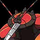 `P0JA` **Buzzwole** — Bug&Fighting · `STR` · Atk `139` / SpA `53` *(tầm cũ: `200`)*
- [x]  `P1DA` **Entei** — Fire · `STR` · Atk `85` / SpA `75` *(tầm cũ: `200`)*
- [x] 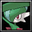 `EN0C` **Gallade** — Psychic&Fighting · `STR` · Atk `65` / SpA `115` *(tầm cũ: `150`)*
- [x] 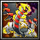 `E028` **Giratina** — Ghost&Dragon · `STR` · Atk `120` / SpA `120` *(tầm cũ: `250`)*
- [x]  `P4UA` **Groudon** — Ground · `STR` · Atk `140` / SpA `90` *(tầm cũ: `200`)*
- [x] 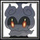 `EL0M` **Marshadow** — Fighting&Ghost · `STR` · Atk `80` / SpA `90` *(tầm cũ: `200`)*
- [x] 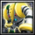 `E025` **Regigigas** — Normal · `STR` · Atk `110` / SpA `110` *(tầm cũ: `200`)*
- [x]  `P3BA` **Regirock** — Rock · `STR` · Atk `200` / SpA `100` *(tầm cũ: `200`)*
- [x]  `EL01` **Registeel** — Steel · `STR` · Atk `150` / SpA `150` *(tầm cũ: `200`)*
- [x] 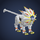 `EL0I` **Solgaleo** — Psychic&Steel · `STR` · Atk `107` / SpA `89` *(tầm cũ: `200`)*
- [x] 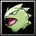 `EN08` **Tyranitar** — Rock&Dark · `STR` · Atk `110` / SpA `100` *(tầm cũ: `250`)*
- [x] 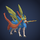 `EL0N` **Zacian** — Fairy&Steel · `STR` · Atk `115` / SpA `115` *(tầm cũ: `200`)*
- [x] 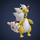 `EL09` **Zekrom** — Dragon&Electric · `STR` · Atk `120` / SpA `100` *(tầm cũ: `200`)*
- [x] 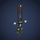 `EL0E` **Zygarde** — Dragon&Ground · `STR` · Atk `121` / SpA `95` *(tầm cũ: `200`)*
- [ ] 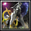 `E02A` **Arceus** — God · `STR` · Atk `120` / SpA `120` *(tầm cũ: `180`)*
- [ ] 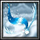 `E020` **Articuno** — Ice&Flying · `INT` · Atk `100` / SpA `125` *(tầm cũ: `500`)*
- [ ]  `EL04` **Azelf** — Psychic · `STR` · Atk `70` / SpA `70` *(tầm cũ: `200`)*
- [ ] 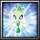 `PZZA` **Celebi** — Psychic&Grass · `STR` · Atk `100` / SpA `100` *(tầm cũ: `200`)*
- [ ]  `EL06` **Cresselia** — Psychic · `INT` · Atk `110` / SpA `120` *(tầm cũ: `200`)*
- [ ]  `E023` **Darkrai** — Dark · `INT` · Atk `90` / SpA `90` *(tầm cũ: `500`)*
- [ ] 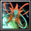 `E027` **Deoxys** — Psychic · `STR` · Atk `50` / SpA `50` *(tầm cũ: `500`)*
- [ ] 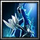 `E04C` **Dialga** — Time · `INT` · Atk `120` / SpA `100` *(tầm cũ: `180`)*
- [ ] 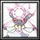 `EL0F` **Diancie** — Rock&Fairy · `STR` · Atk `150` / SpA `150` *(tầm cũ: `200`)*
- [ ] 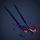 `EL0O` **Eternatus** — Poison&Dragon · `INT` · Atk `95` / SpA `95` *(tầm cũ: `200`)*
- [ ]  `EN0B` **Gardevoir** — Psychic&Fairy · `INT` · Atk `65` / SpA `115` *(tầm cũ: `600`)*
- [ ] 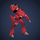 `EL0B` **Genesect** — Bug&Steel · `STR` · Atk `95` / SpA `95` *(tầm cũ: `200`)*
- [ ] 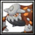 `EL05` **Heatran** — Fire&Steel · `INT` · Atk `106` / SpA `106` *(tầm cũ: `200`)*
- [ ] 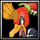 `P1TA` **Ho-Oh** — Fire&Flying · `STR` · Atk `90` / SpA `154` *(tầm cũ: `200`)*
- [ ]  `EL0G` **Hoopa** — Psychic&Ghost · `INT` · Atk `60` / SpA `130` *(tầm cũ: `200`)*
- [ ] 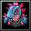 `P1YA` **Hydreigon** — Dark&Dragon · `INT` · Atk `90` / SpA `90` *(tầm cũ: `200`)*
- [ ]  `P20A` **Jigglypuff** — Normal&Fairy · `STR` · Atk `20` / SpA `25` *(tầm cũ: `200`)*
- [ ]  `P21A` **Jirachi** — Steel&Psychic · `STR` · Atk `100` / SpA `100` *(tầm cũ: `200`)*
- [ ]  `P26A` **Kyogre** — Water · `INT` · Atk `90` / SpA `140` *(tầm cũ: `200`)*
- [ ] 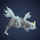 `EL0A` **Kyurem** — Dragon&Ice · `STR` · Atk `90` / SpA `90` *(tầm cũ: `200`)*
- [ ]  `PV2A` **Latias & Latios** — Dragon&Psychic · `INT` · Atk `90` / SpA `120` *(tầm cũ: `200`)*
- [ ]  `EL0J` **Lunala** — Psychic&Ghost · `INT` · Atk `89` / SpA `107` *(tầm cũ: `200`)*
- [ ]  `EL0L` **Magearna** — Steel&Fairy · `INT` · Atk `115` / SpA `115` *(tầm cũ: `200`)*
- [ ] 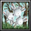 `E032` **Magneton** — Electric&Steel · `INT` · Atk `95` / SpA `70` *(tầm cũ: `350`)*
- [ ]  `P4XA` **Magneton** — Electric&Steel · `INT` · Atk `95` / SpA `70` *(tầm cũ: `200`)*
- [ ]  `P2LA` **Magnezone** — Electric&Steel · `INT` · Atk `115` / SpA `90` *(tầm cũ: `200`)*
- [ ]  `EL03` **Mesprit** — Psychic · `STR` · Atk `105` / SpA `105` *(tầm cũ: `200`)*
- [ ] 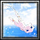 `E024` **Mew** — Psychic · `STR` · Atk `100` / SpA `100` *(tầm cũ: `400`)*
- [ ] 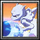 `E026` **Mewtwo** — Psychic · `INT` · Atk `90` / SpA `90` *(tầm cũ: `500`)*
- [ ]  `P2UA` **Misdreavus** — Ghost · `INT` · Atk `60` / SpA `85` *(tầm cũ: `200`)*
- [ ] 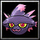 `P2VA` **Mismagius** — Ghost · `INT` · Atk `60` / SpA `105` *(tầm cũ: `200`)*
- [ ] 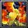 `E021` **Moltres** — Fire&Flying · `INT` · Atk `90` / SpA `85` *(tầm cũ: `500`)*
- [ ] 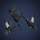 `EL0K` **Necrozma** — Psychic · `INT` · Atk `101` / SpA `89` *(tầm cũ: `200`)*
- [ ] 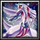 `E04D` **Palkia** — Space · `INT` · Atk `100` / SpA `120` *(tầm cũ: `180`)*
- [ ]  `P39A` **Raikou** — Electric · `INT` · Atk `75` / SpA `100` *(tầm cũ: `200`)*
- [ ] 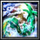 `E029` **Rayquaza** — Dragon&Flying · `STR` · Atk `90` / SpA `90` *(tầm cũ: `500`)*
- [ ] 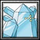 `EL00` **Regice** — Ice · `INT` · Atk `100` / SpA `200` *(tầm cũ: `200`)*
- [ ]  `EL08` **Reshiram** — Dragon&Fire · `INT` · Atk `100` / SpA `120` *(tầm cũ: `200`)*
- [ ] 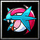 `EN0F` **Salamence** — Dragon&Flying · `STR` · Atk `80` / SpA `80` *(tầm cũ: `350`)*
- [ ]  `P3XA` **Suicune** — Water · `INT` · Atk `115` / SpA `115` *(tầm cũ: `200`)*
- [ ] 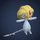 `EL02` **Uxie** — Psychic · `STR` · Atk `130` / SpA `130` *(tầm cũ: `200`)*
- [ ] 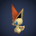 `EL07` **Victini** — Psychic&Fire · `STR` · Atk `100` / SpA `100` *(tầm cũ: `200`)*
- [ ] 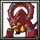 `EL0H` **Volcanion** — Fire&Water · `INT` · Atk `120` / SpA `90` *(tầm cũ: `200`)*
- [ ]  `P4IA` **Wigglytuff** — Normal&Fairy · `INT` · Atk `45` / SpA `50` *(tầm cũ: `200`)*
- [ ]  `EL0C` **Xerneas** — Fairy · `STR` · Atk `95` / SpA `98` *(tầm cũ: `200`)*
- [ ]  `EL0D` **Yveltal** — Dark&Flying · `STR` · Atk `95` / SpA `98` *(tầm cũ: `200`)*
- [ ] 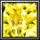 `E03J` **Zapdos** — Electric&Flying · `INT` · Atk `85` / SpA `90` *(tầm cũ: `500`)*

---

## 2. Classic, Starter & Tiến Hóa (Gen 1–6) (152 con — đang tick **95 Melee** / **57 Archer**)

- [x]  `EN0K` **Absol** — Dark · `STR` · Atk `60` / SpA `60` *(tầm cũ: `150`)*
- [x] 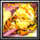 `E01C` **Arcanine** — Fire · `STR` · Atk `80` / SpA `80` *(tầm cũ: `200`)*
- [x]  `EN0D` **Bagon** — Dragon&Flying · `STR` · Atk `60` / SpA `30` *(tầm cũ: `150`)*
- [x]  `EN0G` **Beldum** — Steel&Psychic · `STR` · Atk `80` / SpA `60` *(tầm cũ: `350`)*
- [x]  `E02B` **Bellsprout** — Grass&Poison · `STR` · Atk `35` / SpA `30` *(tầm cũ: `250`)*
- [x]  `EN02` **Blaziken** — Fire&Fighting · `STR` · Atk `70` / SpA `70` *(tầm cũ: `200`)*
- [x]  `E01N` **Caterpie** — Bug · `STR` · Atk `35` / SpA `20` *(tầm cũ: `150`)*
- [x] 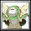 `EP0N` **Chesnaught** — Grass&Fighting · `STR` · Atk `122` / SpA `75` *(tầm cũ: `300`)*
- [x] 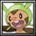 `EP0L` **Chespin** — Grass · `STR` · Atk `65` / SpA `45` *(tầm cũ: `200`)*
- [x]  `EP09` **Chimchar** — Fire · `STR` · Atk `44` / SpA `44` *(tầm cũ: `200`)*
- [x] 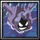 `E01F` **Cloyster** — Water&Ice · `STR` · Atk `180` / SpA `45` *(tầm cũ: `300`)*
- [x]  `EN01` **Combusken** — Fire&Fighting · `STR` · Atk `60` / SpA `60` *(tầm cũ: `250`)*
- [x] 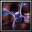 `E049` **Crobat** — Poison&Flying · `STR` · Atk `80` / SpA `80` *(tầm cũ: `300`)*
- [x]  `EP01` **Croconaw** — Water · `STR` · Atk `80` / SpA `63` *(tầm cũ: `300`)*
- [x]  `E01S` **Dratini** — Dragon · `STR` · Atk `45` / SpA `50` *(tầm cũ: `150`)*
- [x] 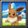 `E03A` **Eevee** — Normal · `STR` · Atk `50` / SpA `65` *(tầm cũ: `128`)*
- [x] 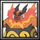 `EP0K` **Emboar** — Fire&Fighting · `STR` · Atk `65` / SpA `65` *(tầm cũ: `200`)*
- [x] 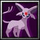 `E03H` **Espeon** — Psychic · `INT` · Atk `60` / SpA `95` *(tầm cũ: `150`)*
- [x] 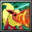 `E038` **Flareon** — Fire · `STR` · Atk `60` / SpA `110` *(tầm cũ: `150`)*
- [x] 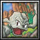 `E00N` **Geodude** — Rock&Ground · `STR` · Atk `100` / SpA `30` *(tầm cũ: `150`)*
- [x] 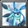 `E03T` **Glaceon** — Ice · `INT` · Atk `110` / SpA `95` *(tầm cũ: `150`)*
- [x] 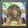 `E00P` **Golem** — Rock&Ground · `STR` · Atk `130` / SpA `65` *(tầm cũ: `250`)*
- [x] 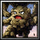 `E00O` **Graveler** — Rock&Ground · `STR` · Atk `115` / SpA `45` *(tầm cũ: `200`)*
- [x] 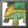 `EP07` **Grotle** — Grass · `STR` · Atk `85` / SpA `65` *(tầm cũ: `250`)*
- [x]  `E03F` **Gyarados** — Water&Flying · `STR` · Atk `79` / SpA `100` *(tầm cũ: `180`)*
- [x]  `E01Z` **Hitmonchan** — Fighting · `STR` · Atk `79` / SpA `110` *(tầm cũ: `128`)*
- [x]  `E03Y` **Hitmonlee** — Fighting · `STR` · Atk `53` / SpA `110` *(tầm cũ: `128`)*
- [x]  `E03Z` **Hitmontop** — Fighting · `STR` · Atk `95` / SpA `110` *(tầm cũ: `128`)*
- [x]  `EP0W` **Incineroar** — Fire&Dark · `STR` · Atk `90` / SpA `90` *(tầm cũ: `200`)*
- [x]  `EP0B` **Infernape** — Fire&Fighting · `STR` · Atk `71` / SpA `71` *(tầm cũ: `200`)*
- [x]  `E01E` **Jolteon** — Electric · `INT` · Atk `60` / SpA `95` *(tầm cũ: `150`)*
- [x]  `E03P` **Kabuto** — Rock&Water · `STR` · Atk `90` / SpA `45` *(tầm cũ: `150`)*
- [x]  `E035` **Kabutops** — Rock&Water · `STR` · Atk `105` / SpA `70` *(tầm cũ: `150`)*
- [x]  `E02J` **Kakuna** — Bug&Poison · `STR` · Atk `50` / SpA `25` *(tầm cũ: `150`)*
- [x]  `E02P` **Kangaskhan** — Normal · `STR` · Atk `80` / SpA `80` *(tầm cũ: `128`)*
- [x]  `E03D` **Kingler** — Water · `STR` · Atk `115` / SpA `50` *(tầm cũ: `200`)*
- [x]  `E01V` **Koffing** — Poison · `STR` · Atk `95` / SpA `45` *(tầm cũ: `250`)*
- [x]  `E03C` **Krabby** — Water · `STR` · Atk `90` / SpA `25` *(tầm cũ: `200`)*
- [x]  `EN06` **Larvitar** — Rock&Dark · `STR` · Atk `50` / SpA `50` *(tầm cũ: `150`)*
- [x]  `E03S` **Leafleon** — Grass · `STR` · Atk `130` / SpA `65` *(tầm cũ: `150`)*
- [x]  `EP0U` **Litten** — Fire · `STR` · Atk `40` / SpA `40` *(tầm cũ: `200`)*
- [x]  `EN0J` **Lucario** — Fighting&Steel · `INT` · Atk `70` / SpA `70` *(tầm cũ: `128`)*
- [x]  `E010` **Machamp** — Fighting · `STR` · Atk `80` / SpA `85` *(tầm cũ: `150`)*
- [x]  `E00Z` **Machoke** — Fighting · `STR` · Atk `70` / SpA `60` *(tầm cũ: `150`)*
- [x]  `E00Y` **Machop** — Fighting · `STR` · Atk `50` / SpA `35` *(tầm cũ: `150`)*
- [x]  `E03E` **Magikarp** — Water · `INT` · Atk `55` / SpA `20` *(tầm cũ: `150`)*
- [x]  `E02S` **Mankey** — Fighting · `STR` · Atk `35` / SpA `45` *(tầm cũ: `150`)*
- [x]  `EP04` **Marshtomp** — Water&Ground · `STR` · Atk `70` / SpA `70` *(tầm cũ: `300`)*
- [x]  `EN0I` **Metagross** — Steel&Psychic · `STR` · Atk `130` / SpA `90` *(tầm cũ: `150`)*
- [x]  `EN0H` **Metang** — Steel&Psychic · `STR` · Atk `100` / SpA `80` *(tầm cũ: `350`)*
- [x]  `E01P` **Metapod** — Bug · `INT` · Atk `55` / SpA `25` *(tầm cũ: `150`)*
- [x]  `EP0A` **Monferno** — Fire&Fighting · `STR` · Atk `52` / SpA `52` *(tầm cũ: `250`)*
- [x]  `E040` **Mr.mime** — Psychic · `INT` · Atk `65` / SpA `120` *(tầm cũ: `150`)*
- [x]  `EP03` **Mudkip** — Water · `STR` · Atk `50` / SpA `50` *(tầm cũ: `250`)*
- [x]  `E01J` **Nidoking** — Ground&Poison · `STR` · Atk `77` / SpA `75` *(tầm cũ: `200`)*
- [x]  `E01M` **Nidoran** — Poison · `STR` · Atk `40` / SpA `40` *(tầm cũ: `200`)*
- [x]  `E01L` **Nidorino** — Poison · `STR` · Atk `57` / SpA `55` *(tầm cũ: `200`)*
- [x]  `E03Q` **Omanyte** — Rock&Water · `INT` · Atk `100` / SpA `55` *(tầm cũ: `150`)*
- [x]  `E03R` **Omastar** — Rock&Water · `INT` · Atk `125` / SpA `70` *(tầm cũ: `150`)*
- [x]  `E03U` **Onix** — Rock&Ground · `STR` · Atk `160` / SpA `45` *(tầm cũ: `150`)*
- [x]  `E00B` **Pidgey** — Flying · `STR` · Atk `40` / SpA `35` *(tầm cũ: `300`)*
- [x]  `EP0J` **Pignite** — Fire&Fighting · `STR` · Atk `55` / SpA `55` *(tầm cũ: `250`)*
- [x]  `E03W` **Pinsir** — Bug · `STR` · Atk `100` / SpA `70` *(tầm cũ: `128`)*
- [x]  `E012` **Poliwag** — Water · `STR` · Atk `40` / SpA `40` *(tầm cũ: `250`)*
- [x]  `E013` **Poliwhirl** — Water · `STR` · Atk `65` / SpA `50` *(tầm cũ: `250`)*
- [x]  `E014` **Poliwrath** — Water&Fighting · `STR` · Atk `95` / SpA `90` *(tầm cũ: `250`)*
- [x]  `E02T` **Primeape** — Fighting · `STR` · Atk `60` / SpA `70` *(tầm cũ: `150`)*
- [x]  `EN07` **Pupitar** — Rock&Dark · `STR` · Atk `70` / SpA `70` *(tầm cũ: `200`)*
- [x]  `EP0M` **Quilladin** — Grass · `STR` · Atk `95` / SpA `58` *(tầm cũ: `250`)*
- [x]  `E00U` **Raticate** — Normal · `STR` · Atk `60` / SpA `70` *(tầm cũ: `128`)*
- [x]  `E00T` **Rattata** — Normal · `STR` · Atk `35` / SpA `35` *(tầm cũ: `128`)*
- [x]  `E02Z` **Rhydon** — Rock&Ground · `STR` · Atk `120` / SpA `45` *(tầm cũ: `150`)*
- [x]  `E02Y` **Rhyhorn** — Rock&Ground · `STR` · Atk `95` / SpA `30` *(tầm cũ: `150`)*
- [x]  `E00A` **Sandshrew** — Ground · `STR` · Atk `85` / SpA `30` *(tầm cũ: `150`)*
- [x]  `E00F` **Sandslash** — Ground · `STR` · Atk `110` / SpA `55` *(tầm cũ: `150`)*
- [x]  `E03M` **Scizor** — Bug&Steel · `STR` · Atk `100` / SpA `80` *(tầm cũ: `128`)*
- [x]  `E03L` **Scyther** — Bug&Flying · `STR` · Atk `80` / SpA `80` *(tầm cũ: `128`)*
- [x]  `EP0H` **Serperior** — Grass · `STR` · Atk `95` / SpA `95` *(tầm cũ: `300`)*
- [x]  `EP0G` **Servine** — Grass · `STR` · Atk `75` / SpA `75` *(tầm cũ: `250`)*
- [x]  `EN0E` **Shelgon** — Dragon&Flying · `STR` · Atk `100` / SpA `50` *(tầm cũ: `250`)*
- [x]  `E02E` **Shellder** — Water&Ice · `STR` · Atk `100` / SpA `25` *(tầm cũ: `250`)*
- [x]  `EP0F` **Snivy** — Grass · `STR` · Atk `55` / SpA `55` *(tầm cũ: `200`)*
- [x]  `E03V` **Steelix** — Steel&Ground · `STR` · Atk `200` / SpA `65` *(tầm cũ: `150`)*
- [x]  `E03X` **Sylveon** — Fairy · `INT` · Atk `65` / SpA `130` *(tầm cũ: `128`)*
- [x]  `E018` **Tauros** — Normal · `STR` · Atk `95` / SpA `70` *(tầm cũ: `128`)*
- [x]  `EP0I` **Tepig** — Fire · `STR` · Atk `45` / SpA `45` *(tầm cũ: `200`)*
- [x]  `EP0V` **Torracat** — Fire · `STR` · Atk `50` / SpA `50` *(tầm cũ: `250`)*
- [x]  `EP08` **Torterra** — Grass&Ground · `STR` · Atk `105` / SpA `85` *(tầm cũ: `300`)*
- [x]  `EP00` **Totodile** — Water · `STR` · Atk `64` / SpA `48` *(tầm cũ: `250`)*
- [x]  `EP06` **Turtwig** — Grass · `STR` · Atk `64` / SpA `55` *(tầm cũ: `200`)*
- [x]  `E03I` **Umbreon** — Dark · `STR` · Atk `110` / SpA `130` *(tầm cũ: `150`)*
- [x]  `E037` **Vaporeon** — Water · `INT` · Atk `60` / SpA `95` *(tầm cũ: `150`)*
- [x]  `E02I` **Weedle** — Bug&Poison · `STR` · Atk `30` / SpA `20` *(tầm cũ: `150`)*
- [x]  `E01A` **Weepinbell** — Grass&Poison · `STR` · Atk `50` / SpA `45` *(tầm cũ: `300`)*
- [x]  `E019` **Weezing** — Poison · `STR` · Atk `120` / SpA `70` *(tầm cũ: `300`)*
- [ ]  `E00G` **Abra** — Psychic · `INT` · Atk `15` / SpA `55` *(tầm cũ: `400`)*
- [ ]  `E00I` **Alakazam** — Psychic · `INT` · Atk `45` / SpA `95` *(tầm cũ: `600`)*
- [ ]  `E02K` **Beedrill** — Bug&Poison · `STR` · Atk `40` / SpA `80` *(tầm cũ: `300`)*
- [ ]  `E000` **Blastoise** — Water · `INT` · Atk `100` / SpA `105` *(tầm cũ: `450`)*
- [ ]  `EP0P` **Braixen** — Fire · `INT` · Atk `58` / SpA `70` *(tầm cũ: `250`)*
- [ ]  `E008` **Bulbasaur** — Grass&Poison · `INT` · Atk `49` / SpA `65` *(tầm cũ: `200`)*
- [ ]  `E01Q` **Butterfree** — Bug&Flying · `INT` · Atk `50` / SpA `80` *(tầm cũ: `500`)*
- [ ]  `E00E` **Charizard** — Fire&Flying · `INT` · Atk `78` / SpA `85` *(tầm cũ: `400`)*
- [ ]  `E003` **Charmander** — Fire · `INT` · Atk `43` / SpA `50` *(tầm cũ: `200`)*
- [ ]  `E007` **Charmeleon** — Fire · `INT` · Atk `58` / SpA `65` *(tầm cũ: `250`)*
- [ ]  `EP0Q` **Delphox** — Fire&Psychic · `INT` · Atk `72` / SpA `100` *(tầm cũ: `200`)*
- [ ]  `E01T` **Dragonair** — Dragon · `STR` · Atk `65` / SpA `70` *(tầm cũ: `250`)*
- [ ]  `E01K` **Dragonite** — Dragon&Flying · `STR` · Atk `95` / SpA `100` *(tầm cũ: `350`)*
- [ ]  `E01X` **Electrode** — Electric · `INT` · Atk `70` / SpA `80` *(tầm cũ: `300`)*
- [ ]  `EP0E` **Empoleon** — Water&Steel · `INT` · Atk `88` / SpA `101` *(tầm cũ: `450`)*
- [ ]  `E02U` **Exeggcute** — Grass&Psychic · `INT` · Atk `80` / SpA `45` *(tầm cũ: `200`)*
- [ ]  `E02W` **Exeggutor** — Grass&Psychic · `INT` · Atk `85` / SpA `75` *(tầm cũ: `200`)*
- [ ]  `EP0O` **Fennekin** — Fire · `INT` · Atk `40` / SpA `60` *(tầm cũ: `200`)*
- [ ]  `EP02` **Feraligatr** — Water · `STR` · Atk `100` / SpA `83` *(tầm cũ: `450`)*
- [ ]  `EP0R` **Froakie** — Water · `INT` · Atk `40` / SpA `44` *(tầm cũ: `250`)*
- [ ]  `EP0S` **Frogadier** — Water · `INT` · Atk `52` / SpA `56` *(tầm cũ: `300`)*
- [ ]  `E02G` **Gastly** — Ghost&Poison · `INT` · Atk `30` / SpA `35` *(tầm cũ: `600`)*
- [ ]  `E01G` **Gengar** — Ghost&Poison · `INT` · Atk `60` / SpA `75` *(tầm cũ: `600`)*
- [ ]  `E048` **Golbat** — Poison&Flying · `STR` · Atk `70` / SpA `75` *(tầm cũ: `300`)*
- [ ]  `EP0T` **Greninja** — Water&Dark · `INT` · Atk `67` / SpA `71` *(tầm cũ: `450`)*
- [ ]  `EN04` **Grovyle** — Grass · `INT` · Atk `45` / SpA `65` *(tầm cũ: `250`)*
- [ ]  `E02F` **Growlithe** — Fire · `STR` · Atk `45` / SpA `50` *(tầm cũ: `200`)*
- [ ]  `E02H` **Haunter** — Ghost&Poison · `INT` · Atk `45` / SpA `55` *(tầm cũ: `600`)*
- [ ]  `E001` **Ivysaur** — Grass&Poison · `INT` · Atk `63` / SpA `80` *(tầm cũ: `250`)*
- [ ]  `E00H` **Kadabra** — Psychic · `INT` · Atk `30` / SpA `70` *(tầm cũ: `500`)*
- [ ]  `EN0A` **Kirlia** — Psychic&Fairy · `INT` · Atk `35` / SpA `55` *(tầm cũ: `500`)*
- [ ]  `E031` **Magnemite** — Electric&Steel · `INT` · Atk `70` / SpA `55` *(tầm cũ: `350`)*
- [ ]  `E04P` **Ninetales** — Fire · `INT` · Atk `75` / SpA `100` *(tầm cũ: `200`)*
- [ ]  `E00D` **Pidgeot** — Flying · `STR` · Atk `75` / SpA `70` *(tầm cũ: `600`)*
- [ ]  `E00C` **Pidgeotto** — Flying · `STR` · Atk `55` / SpA `50` *(tầm cũ: `450`)*
- [ ]  `E005` **Pikachu** — Electric · `STR` · Atk `40` / SpA `50` *(tầm cũ: `250`)*
- [ ]  `EP0C` **Piplup** — Water · `INT` · Atk `53` / SpA `56` *(tầm cũ: `250`)*
- [ ]  `E01B` **Ponyta** — Fire · `STR` · Atk `55` / SpA `65` *(tầm cũ: `200`)*
- [ ]  `EP0D` **Prinplup** — Water · `INT` · Atk `68` / SpA `76` *(tầm cũ: `300`)*
- [ ]  `E006` **Raichu** — Electric · `STR` · Atk `55` / SpA `80` *(tầm cũ: `400`)*
- [ ]  `EN09` **Ralts** — Psychic&Fairy · `INT` · Atk `25` / SpA `35` *(tầm cũ: `400`)*
- [ ]  `E01H` **Rapidash** — Fire · `STR` · Atk `70` / SpA `80` *(tầm cũ: `200`)*
- [ ]  `EN05` **Sceptile** — Grass · `INT` · Atk `65` / SpA `85` *(tầm cũ: `300`)*
- [ ]  `E004` **Squirtle** — Water · `INT` · Atk `65` / SpA `64` *(tầm cũ: `250`)*
- [ ]  `E04M` **Starmie** — Water&Psychic · `INT` · Atk `85` / SpA `85` *(tầm cũ: `350`)*
- [ ]  `E04N` **Staryu** — Water · `INT` · Atk `55` / SpA `55` *(tầm cũ: `350`)*
- [ ]  `EP05` **Swampert** — Water&Ground · `STR` · Atk `90` / SpA `90` *(tầm cũ: `450`)*
- [ ]  `E02D` **Tentacool** — Water&Poison · `INT` · Atk `35` / SpA `100` *(tầm cũ: `250`)*
- [ ]  `E01I` **Tentacruel** — Water&Poison · `INT` · Atk `65` / SpA `120` *(tầm cũ: `300`)*
- [ ]  `EN00` **Torchic** — Fire&Fighting · `INT` · Atk `40` / SpA `50` *(tầm cũ: `200`)*
- [ ]  `EN03` **Treecko** — Grass · `INT` · Atk `35` / SpA `55` *(tầm cũ: `200`)*
- [ ]  `E002` **Venusaur** — Grass&Poison · `INT` · Atk `83` / SpA `100` *(tầm cũ: `300`)*
- [ ]  `E02C` **Victreebel** — Grass&Poison · `STR` · Atk `65` / SpA `70` *(tầm cũ: `400`)*
- [ ]  `E01D` **Voltorb** — Electric · `INT` · Atk `50` / SpA `55` *(tầm cũ: `250`)*
- [ ]  `E04O` **Vulpix** — Fire · `INT` · Atk `40` / SpA `65` *(tầm cũ: `200`)*
- [ ]  `E009` **Wartortle** — Water · `INT` · Atk `80` / SpA `80` *(tầm cũ: `300`)*
- [ ]  `E046` **Zubat** — Poison&Flying · `STR` · Atk `35` / SpA `40` *(tầm cũ: `300`)*

---

## 3. Pokemon Rừng / Soul (Gen 2–9) (147 con — đang tick **55 Melee** / **92 Archer**)

- [x]  `P4QA` **Aegislash** — Steel&Ghost · `STR` · Atk `140` / SpA `140` *(tầm cũ: `200`)*
- [x]  `P03A` **Alolan-Geodude** — Rock&Electric · `STR` · Atk `100` / SpA `30` *(tầm cũ: `200`)*
- [x]  `P04A` **Alolan-Golem** — Rock&Electric · `STR` · Atk `130` / SpA `65` *(tầm cũ: `200`)*
- [x]  `P05A` **Alolan-Graveler** — Rock&Electric · `STR` · Atk `115` / SpA `45` *(tầm cũ: `200`)*
- [x]  `P4MA` **Alolan-Sandshrew** — Ice&Steel · `STR` · Atk `90` / SpA `35` *(tầm cũ: `200`)*
- [x]  `P4NA` **Alolan-Sandslash** — Ice&Steel · `STR` · Atk `120` / SpA `65` *(tầm cũ: `200`)*
- [x]  `P4SA` **Bisharp** — Dark&Steel · `STR` · Atk `100` / SpA `70` *(tầm cũ: `200`)*
- [x]  `P0HA` **Bonsly** — Rock · `STR` · Atk `95` / SpA `45` *(tầm cũ: `200`)*
- [x]  `P0IA` **Breloom** — Grass&Fighting · `STR` · Atk `80` / SpA `60` *(tầm cũ: `200`)*
- [x]  `P0KA` **Carvanha** — Water&Dark · `STR` · Atk `20` / SpA `20` *(tầm cũ: `200`)*
- [x]  `P0NA` **Chikorita** — Grass · `STR` · Atk `65` / SpA `65` *(tầm cũ: `200`)*
- [x]  `P0UA` **Croagunk** — Poison&Fighting · `STR` · Atk `40` / SpA `40` *(tầm cũ: `200`)*
- [x]  `P0VA` **Cubone** — Ground · `STR` · Atk `95` / SpA `50` *(tầm cũ: `200`)*
- [x]  `P0XA` **Darmanitan** — Fire · `STR` · Atk `55` / SpA `55` *(tầm cũ: `200`)*
- [x]  `P0YA` **Darumaka** — Fire · `STR` · Atk `45` / SpA `45` *(tầm cũ: `200`)*
- [x]  `P0ZA` **Deino** — Dark&Dragon · `STR` · Atk `50` / SpA `50` *(tầm cũ: `200`)*
- [x]  `P12A` **Ditto** — Normal · `STR` · Atk `48` / SpA `48` *(tầm cũ: `200`)*
- [x]  `P4PA` **Doublade** — Steel&Ghost · `STR` · Atk `150` / SpA `49` *(tầm cũ: `200`)*
- [x]  `P1HA` **Flygon** — Ground&Dragon · `STR` · Atk `80` / SpA `80` *(tầm cũ: `200`)*
- [x]  `P1IA` **Gabite** — Dragon&Ground · `STR` · Atk `65` / SpA `55` *(tầm cũ: `200`)*
- [x]  `P1LA` **Garchomp** — Dragon&Ground · `STR` · Atk `95` / SpA `85` *(tầm cũ: `200`)*
- [x]  `P1NA` **Gible** — Dragon&Ground · `STR` · Atk `45` / SpA `45` *(tầm cũ: `200`)*
- [x]  `P1QA` **Granbull** — Fairy · `STR` · Atk `75` / SpA `60` *(tầm cũ: `200`)*
- [x]  `P4OA` **Honedge** — Steel&Ghost · `STR` · Atk `100` / SpA `37` *(tầm cũ: `200`)*
- [x]  `P4TA` **Kingambit** — Dark&Steel · `STR` · Atk `120` / SpA `85` *(tầm cũ: `200`)*
- [x]  `P24A` **Kingdra** — Water&Dragon · `STR` · Atk `95` / SpA `95` *(tầm cũ: `200`)*
- [x]  `P2BA` **Leafeon** — Grass · `STR` · Atk `0` / SpA `0` *(tầm cũ: `200`)*
- [x]  `P2MA` **Mamoswine** — Ice&Ground · `STR` · Atk `80` / SpA `60` *(tầm cũ: `200`)*
- [x]  `P2PA` **Marowak** — Ground · `STR` · Atk `110` / SpA `80` *(tầm cũ: `200`)*
- [x]  `P2XA` **Nincada** — Bug&Ground · `STR` · Atk `90` / SpA `30` *(tầm cũ: `200`)*
- [x]  `P4RA` **Pawniard** — Dark&Steel · `STR` · Atk `70` / SpA `40` *(tầm cũ: `200`)*
- [x]  `P32A` **Piloswine** — Ice&Ground · `STR` · Atk `80` / SpA `60` *(tầm cũ: `200`)*
- [x]  `P4YA` **Poliwag** — Water · `STR` · Atk `40` / SpA `40` *(tầm cũ: `200`)*
- [x]  `P4ZA` **Poliwhirl** — Water · `STR` · Atk `65` / SpA `50` *(tầm cũ: `200`)*
- [x]  `P51A` **Rhydon** — Ground&Rock · `STR` · Atk `120` / SpA `45` *(tầm cũ: `200`)*
- [x]  `P50A` **Rhyhorn** — Ground&Rock · `STR` · Atk `95` / SpA `30` *(tầm cũ: `200`)*
- [x]  `P3CA` **Rhyperior** — Ground&Rock · `STR` · Atk `130` / SpA `55` *(tầm cũ: `200`)*
- [x]  `P3DA` **Sableye** — Dark&Ghost · `STR` · Atk `75` / SpA `65` *(tầm cũ: `200`)*
- [x]  `P3IA` **Sharpedo** — Water&Dark · `STR` · Atk `40` / SpA `40` *(tầm cũ: `200`)*
- [x]  `P3JA` **Shedinja** — Bug&Ghost · `STR` · Atk `45` / SpA `30` *(tầm cũ: `200`)*
- [x]  `P3LA` **Shroomish** — Grass · `STR` · Atk `60` / SpA `60` *(tầm cũ: `200`)*
- [x]  `P3MA` **Sirfetch'd** — Fighting · `STR` · Atk `95` / SpA `82` *(tầm cũ: `200`)*
- [x]  `P3PA` **Slowpoke** — Water&Psychic · `STR` · Atk `65` / SpA `40` *(tầm cũ: `200`)*
- [x]  `P3VA` **Snubbull** — Fairy · `STR` · Atk `50` / SpA `40` *(tầm cũ: `200`)*
- [x]  `P3WA` **Sudowoodo** — Rock · `STR` · Atk `115` / SpA `65` *(tầm cũ: `200`)*
- [x]  `P3ZA` **Swinub** — Ice&Ground · `STR` · Atk `40` / SpA `30` *(tầm cũ: `200`)*
- [x]  `P42A` **Tauros Aqua** — Fighting&Water · `STR` · Atk `105` / SpA `70` *(tầm cũ: `200`)*
- [x]  `P43A` **Tauros Blaze** — Fighting&Fire · `STR` · Atk `105` / SpA `70` *(tầm cũ: `200`)*
- [x]  `P44A` **Tauros Combat** — Fighting · `STR` · Atk `105` / SpA `70` *(tầm cũ: `200`)*
- [x]  `P49A` **Torkoal** — Fire · `STR` · Atk `140` / SpA `70` *(tầm cũ: `200`)*
- [x]  `P4AA` **Toxicroak** — Poison&Fighting · `STR` · Atk `65` / SpA `65` *(tầm cũ: `200`)*
- [x]  `P4BA` **Trapinch** — Ground · `STR` · Atk `45` / SpA `45` *(tầm cũ: `200`)*
- [x]  `P4EA` **Tyrogue** — Fighting · `STR` · Atk `35` / SpA `35` *(tầm cũ: `200`)*
- [x]  `P4FA` **Vibrava** — Ground&Dragon · `STR` · Atk `50` / SpA `50` *(tầm cũ: `200`)*
- [x]  `P4LA` **Zweilous** — Dark&Dragon · `STR` · Atk `70` / SpA `70` *(tầm cũ: `200`)*
- [ ]  `P00A` **Abomasnow** — Grass&Ice · `STR` · Atk `75` / SpA `85` *(tầm cũ: `200`)*
- [ ]  `P02A` **Aerodactyl** — Rock&Flying · `STR` · Atk `65` / SpA `75` *(tầm cũ: `200`)*
- [ ]  `P06A` **Alolan-Raichu** — Electric&Psychic · `INT` · Atk `50` / SpA `85` *(tầm cũ: `200`)*
- [ ]  `P08A` **Ampharos** — Electric · `INT` · Atk `85` / SpA `90` *(tầm cũ: `200`)*
- [ ]  `P09A` **Arbok** — Poison · `STR` · Atk `69` / SpA `79` *(tầm cũ: `200`)*
- [ ]  `P0BA` **Baltoy** — Ground&Psychic · `STR` · Atk `55` / SpA `70` *(tầm cũ: `200`)*
- [ ]  `P0CA` **Bayleef** — Grass · `INT` · Atk `80` / SpA `80` *(tầm cũ: `200`)*
- [ ]  `P0EA` **Bellossom** — Grass · `INT` · Atk `95` / SpA `100` *(tầm cũ: `200`)*
- [ ]  `P0GA` **Blissey** — Normal · `INT` · Atk `10` / SpA `135` *(tầm cũ: `200`)*
- [ ]  `P0LA` **Chandelure** — Ghost&Fire · `INT` · Atk `90` / SpA `90` *(tầm cũ: `200`)*
- [ ]  `P0MA` **Chansey** — Normal · `INT` · Atk `5` / SpA `105` *(tầm cũ: `200`)*
- [ ]  `P0OA` **Chinchou** — Water&Electric · `INT` · Atk `38` / SpA `56` *(tầm cũ: `200`)*
- [ ]  `P0PA` **Claydol** — Ground&Psychic · `STR` · Atk `105` / SpA `120` *(tầm cũ: `200`)*
- [ ]  `P0QA` **Clefable** — Fairy · `INT` · Atk `73` / SpA `90` *(tầm cũ: `200`)*
- [ ]  `P0RA` **Clefairy** — Fairy · `INT` · Atk `48` / SpA `65` *(tầm cũ: `200`)*
- [ ]  `P0TA` **Cradily** — Rock&Grass · `STR` · Atk `97` / SpA `107` *(tầm cũ: `200`)*
- [ ]  `P0WA` **Cyndaquil** — Fire · `INT` · Atk `43` / SpA `50` *(tầm cũ: `200`)*
- [ ]  `P10A` **Dewgong** — Water&Ice · `STR` · Atk `80` / SpA `95` *(tầm cũ: `200`)*
- [ ]  `P11A` **Diglett** — Ground · `STR` · Atk `25` / SpA `45` *(tầm cũ: `200`)*
- [ ]  `P13A` **Drowzee** — Psychic · `STR` · Atk `45` / SpA `90` *(tầm cũ: `200`)*
- [ ]  `P14A` **Dugtrio** — Ground · `STR` · Atk `50` / SpA `70` *(tầm cũ: `200`)*
- [ ]  `P15A` **Dusclops** — Ghost · `STR` · Atk `130` / SpA `130` *(tầm cũ: `200`)*
- [ ]  `P16A` **Dusknoir** — Ghost · `STR` · Atk `135` / SpA `135` *(tầm cũ: `200`)*
- [ ]  `P17A` **Duskull** — Ghost · `STR` · Atk `90` / SpA `90` *(tầm cũ: `200`)*
- [ ]  `P4VA` **Eevee** — Normal · `STR` · Atk `50` / SpA `65` *(tầm cũ: `200`)*
- [ ]  `P18A` **Ekans** — Poison · `STR` · Atk `44` / SpA `54` *(tầm cũ: `200`)*
- [ ]  `P19A` **Electabuzz** — Electric · `INT` · Atk `57` / SpA `85` *(tầm cũ: `200`)*
- [ ]  `P1AA` **Electivire** — Electric · `STR` · Atk `67` / SpA `85` *(tầm cũ: `200`)*
- [ ]  `P1BA` **Electrike** — Electric · `INT` · Atk `40` / SpA `40` *(tầm cũ: `200`)*
- [ ]  `P1CA` **Elekid** — Electric · `INT` · Atk `37` / SpA `55` *(tầm cũ: `200`)*
- [ ]  `P1EA` **Farfetch'd** — Normal&Flying · `STR` · Atk `55` / SpA `62` *(tầm cũ: `200`)*
- [ ]  `P1FA` **Feebas** — Water · `STR` · Atk `20` / SpA `55` *(tầm cũ: `200`)*
- [ ]  `P1GA` **Flaaffy** — Electric · `INT` · Atk `55` / SpA `60` *(tầm cũ: `200`)*
- [ ]  `P1KA` **Galvantula** — Bug&Electric · `INT` · Atk `60` / SpA `60` *(tầm cũ: `200`)*
- [ ]  `P1OA` **Gloom** — Grass&Poison · `INT` · Atk `70` / SpA `75` *(tầm cũ: `200`)*
- [ ]  `P1PA` **Golduck** — Water · `INT` · Atk `78` / SpA `80` *(tầm cũ: `200`)*
- [ ]  `P1SA` **Heracross** — Bug&Fighting · `STR` · Atk `75` / SpA `95` *(tầm cũ: `200`)*
- [ ]  `P1UA` **Hoothoot** — Normal&Flying · `INT` · Atk `30` / SpA `56` *(tầm cũ: `200`)*
- [ ]  `P1VA` **Horsea** — Water · `INT` · Atk `70` / SpA `25` *(tầm cũ: `200`)*
- [ ]  `P1WA` **Houndoom** — Dark&Fire · `INT` · Atk `50` / SpA `80` *(tầm cũ: `200`)*
- [ ]  `P1XA` **Houndour** — Dark&Fire · `INT` · Atk `30` / SpA `50` *(tầm cũ: `200`)*
- [ ]  `P1ZA` **Hypno** — Psychic · `STR` · Atk `70` / SpA `115` *(tầm cũ: `200`)*
- [ ]  `P22A` **Joltik** — Bug&Electric · `INT` · Atk `50` / SpA `50` *(tầm cũ: `200`)*
- [ ]  `P23A` **Jynx** — Ice&Psychic · `INT` · Atk `35` / SpA `95` *(tầm cũ: `200`)*
- [ ]  `P27A` **Lampent** — Ghost&Fire · `INT` · Atk `60` / SpA `60` *(tầm cũ: `200`)*
- [ ]  `P28A` **Lanturn** — Water&Electric · `INT` · Atk `58` / SpA `76` *(tầm cũ: `200`)*
- [ ]  `P29A` **Lapras** — Water&Ice · `STR` · Atk `80` / SpA `95` *(tầm cũ: `200`)*
- [ ]  `P2CA` **Lileep** — Rock&Grass · `INT` · Atk `77` / SpA `87` *(tầm cũ: `200`)*
- [ ]  `P2DA` **Litwick** — Ghost&Fire · `INT` · Atk `55` / SpA `55` *(tầm cũ: `200`)*
- [ ]  `P2EA` **Lombre** — Water&Grass · `INT` · Atk `50` / SpA `70` *(tầm cũ: `200`)*
- [ ]  `P2FA` **Lotad** — Water&Grass · `INT` · Atk `30` / SpA `50` *(tầm cũ: `200`)*
- [ ]  `P2GA` **Ludicolo** — Water&Grass · `INT` · Atk `70` / SpA `100` *(tầm cũ: `200`)*
- [ ]  `P2HA` **Magby** — Fire · `STR` · Atk `37` / SpA `55` *(tầm cũ: `200`)*
- [ ]  `P2IA` **Magcargo** — Fire&Rock · `INT` · Atk `120` / SpA `80` *(tầm cũ: `200`)*
- [ ]  `P2JA` **Magmar** — Fire · `INT` · Atk `57` / SpA `85` *(tầm cũ: `200`)*
- [ ]  `P2KA` **Magmortar** — Fire · `INT` · Atk `67` / SpA `95` *(tầm cũ: `200`)*
- [ ]  `P4WA` **Magnemite** — Electric&Steel · `INT` · Atk `70` / SpA `55` *(tầm cũ: `200`)*
- [ ]  `P2NA` **Manectric** — Electric · `INT` · Atk `60` / SpA `60` *(tầm cũ: `200`)*
- [ ]  `P2OA` **Mareep** — Electric · `INT` · Atk `40` / SpA `45` *(tầm cũ: `200`)*
- [ ]  `PV0A` **Meganium** — Grass · `INT` · Atk `0` / SpA `0` *(tầm cũ: `200`)*
- [ ]  `P2QA` **Meowth** — Normal · `STR` · Atk `35` / SpA `40` *(tầm cũ: `200`)*
- [ ]  `P2TA` **Milotic** — Water · `INT` · Atk `79` / SpA `125` *(tầm cũ: `200`)*
- [ ]  `P2WA` **Mr. Mime** — Psychic&Fairy · `INT` · Atk `0` / SpA `0` *(tầm cũ: `200`)*
- [ ]  `P2YA` **Ninjask** — Bug&Flying · `STR` · Atk `45` / SpA `50` *(tầm cũ: `200`)*
- [ ]  `P2ZA` **Noctowl** — Normal&Flying · `INT` · Atk `50` / SpA `96` *(tầm cũ: `200`)*
- [ ]  `P30A` **Oddish** — Grass&Poison · `INT` · Atk `55` / SpA `65` *(tầm cũ: `200`)*
- [ ]  `P31A` **Persian** — Normal · `STR` · Atk `60` / SpA `65` *(tầm cũ: `200`)*
- [ ]  `P34A` **Politoed** — Water · `INT` · Atk `75` / SpA `100` *(tầm cũ: `200`)*
- [ ]  `P35A` **Porygon** — Normal · `INT` · Atk `70` / SpA `75` *(tầm cũ: `200`)*
- [ ]  `PV1A` **Porygon2** — Normal · `INT` · Atk `0` / SpA `0` *(tầm cũ: `200`)*
- [ ]  `P36A` **Psyduck** — Water · `INT` · Atk `48` / SpA `50` *(tầm cũ: `200`)*
- [ ]  `P38A` **Quilava** — Fire · `INT` · Atk `58` / SpA `65` *(tầm cũ: `200`)*
- [ ]  `P3GA` **Seadra** — Water · `INT` · Atk `95` / SpA `45` *(tầm cũ: `200`)*
- [ ]  `P3HA` **Seel** — Water · `STR` · Atk `55` / SpA `70` *(tầm cũ: `200`)*
- [ ]  `P3NA` **Slowbro** — Water&Psychic · `INT` · Atk `110` / SpA `80` *(tầm cũ: `200`)*
- [ ]  `P3OA` **Slowking** — Water&Psychic · `INT` · Atk `80` / SpA `110` *(tầm cũ: `200`)*
- [ ]  `P3QA` **Slugma** — Fire · `INT` · Atk `40` / SpA `40` *(tầm cũ: `200`)*
- [ ]  `P3RA` **Smoochum** — Ice&Psychic · `INT` · Atk `15` / SpA `65` *(tầm cũ: `200`)*
- [ ]  `P3SA` **Sneasel** — Dark&Ice · `STR` · Atk `55` / SpA `75` *(tầm cũ: `200`)*
- [ ]  `P3TA` **Snorlax** — Normal · `STR` · Atk `65` / SpA `110` *(tầm cũ: `200`)*
- [ ]  `P3UA` **Snover** — Grass&Ice · `STR` · Atk `50` / SpA `60` *(tầm cũ: `200`)*
- [ ]  `P3YA` **Swablu** — Normal&Flying · `STR` · Atk `60` / SpA `75` *(tầm cũ: `200`)*
- [ ]  `P40A` **Tangela** — Grass · `INT` · Atk `115` / SpA `40` *(tầm cũ: `200`)*
- [ ]  `P41A` **Tangrowth** — Grass · `INT` · Atk `125` / SpA `50` *(tầm cũ: `200`)*
- [ ]  `P45A` **Togekiss** — Fairy&Flying · `INT` · Atk `95` / SpA `115` *(tầm cũ: `200`)*
- [ ]  `P46A` **Togepi** — Fairy · `INT` · Atk `65` / SpA `65` *(tầm cũ: `200`)*
- [ ]  `P47A` **Togetic** — Fairy&Flying · `INT` · Atk `85` / SpA `105` *(tầm cũ: `200`)*
- [ ]  `P4DA` **Typhlosion** — Fire · `INT` · Atk `78` / SpA `85` *(tầm cũ: `200`)*
- [ ]  `P4GA` **Vileplume** — Grass&Poison · `INT` · Atk `85` / SpA `90` *(tầm cũ: `200`)*
- [ ]  `P4HA` **Weavile** — Dark&Ice · `STR` · Atk `65` / SpA `85` *(tầm cũ: `200`)*
- [ ]  `P4JA` **Wobbuffet** — Psychic · `STR` · Atk `58` / SpA `58` *(tầm cũ: `200`)*
- [ ]  `P4KA` **Wynaut** — Psychic · `STR` · Atk `48` / SpA `48` *(tầm cũ: `200`)*
